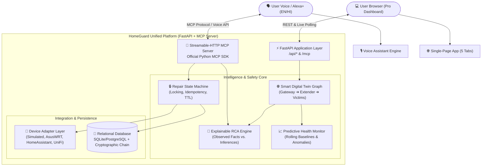

# HomeGuard Pro: AI-Powered Home Network Reliability Platform

> *"Turn home network chaos into clarity: Digital twin topology, deterministic explainable RCA, predictive degradation alerts, voice-first bilingual assistant (English & Hindi), policy-controlled repairs, and cryptographic auditability."*

Built for the **Amazon "Build, Ship, Shape" Hackathon (Alexa+ Track)**.

---

> [!WARNING]
> **SIMULATED DEVICES NOTICE**  
> **All smart home devices in HomeGuard Pro (Router, Wi-Fi Extender, Ring Doorbell, Fire TV, Echo Speaker) are strictly SIMULATED.**  
> HomeGuard does not make unauthorized hardware calls to real network backbones. It provides a production-grade architecture featuring simulated adapters alongside real-world interface specifications (AsusWRT, Home Assistant, UniFi).

---

## 💡 The Problem

Smart homes fail in bewildering cascade patterns. When an intermediate device like a Wi-Fi extender crashes or suffers RF interference:
- Your **Ring Video Doorbell** goes offline.
- Your **Fire TV 4K** starts buffering or drops video bitrate.
- Your **Echo Speaker** says *"Sorry, something went wrong"*.

To homeowners, this looks like three unrelated breakdowns. Families reboot their Fire TV, power-cycle their Echo, or reinstall the Ring app—wasting hours fixing symptoms while the root cause remains unaddressed.

---

## 🛡️ The Six Core Capabilities of HomeGuard Pro

1. **Observe (Digital Twin)**: Models routers, extenders, security cameras, streaming devices, and smart speakers as a live dependency graph with real-time status and telemetry history.
2. **Diagnose (Explainable Bilingual RCA)**: Deterministic dependency correlation separates the single root cause from collateral victims, displaying calibrated confidence and evidence in plain English and Hindi (हिंदी).
3. **Predict (Network Health & Baselines)**: Monitors rolling baselines for latency, packet loss, and reconnects to flag degradation before complete failure occurs.
4. **Repair (Policy-Controlled State Machine)**: Evaluates downtime and blast radius, considers safer alternatives, requires explicit user approval, validates proposal TTL & state fingerprints, and prevents duplicate executions.
5. **Verify (Consecutive Stabilization Checks)**: Validates health across consecutive ticks before declaring recovery.
6. **Protect (Cryptographic Audit & Safe Rollback)**: Automatically reverts to a pre-fix snapshot if stabilization fails and maintains a tamper-evident SHA-256 hash-chained event ledger.

---

## 🏗️ Production-Grade Architecture



---

## 🎙️ Professional MCP Tool Contracts

HomeGuard exposes six well-defined tools conforming to the Model Context Protocol (MCP) using Streamable-HTTP transport:

| MCP Tool | Required Output | Voice Output (`spoken` / `spoken_hindi`) |
|---|---|---|
| `get_status` | Device inventory, health metrics, last-seen timestamps | *"All 5 simulated devices in your home are online and working normally."* |
| `diagnose` | Ranked root causes, observed facts, inferred hypotheses, confidence | *"I found the issue. Your Wi-Fi Extender is offline. It is causing 3 other devices to fail."* |
| `propose_fix` | Proposal ID, action, risk tier, estimated downtime, expiry, alternatives | *"Restarting your Wi-Fi Extender will briefly disconnect 4 devices for 60s. Should I proceed?"* |
| `approve_fix` | Approval result, execution job ID, idempotency confirmation | *"I've restarted your Wi-Fi Extender. Checking if everything stabilizes."* |
| `verify_fix` | Multi-tick verification checks, recovery confirmation, auto-rollback | *"All devices have stabilized across 3 checks. Your Ring, Fire TV, and Echo are all back online."* |
| `rollback_fix` | Compensating action, restored snapshot, rollback status | *"I have rolled back the fix and restored your devices to their previous state."* |

*(Note: `home_status` and `diagnose_home` are preserved as backward-compatible aliases).*

---

## 🎯 Measurable Success Criteria & Benchmark Results

HomeGuard Pro features an automated reliability test runner that evaluates safety and diagnostic accuracy:

| Metric | Target | HomeGuard Pro Verified Result |
|---|---|---|
| Known Simulated Fault Scenarios | At least 8 | **8 Scenarios Tested & Passing** |
| Root-Cause Accuracy on Scenarios | >= 90% | **100% Accuracy (8/8)** |
| Unauthorized Repair Executions | 0 | **0 (Strict confirmation gates)** |
| Duplicate Executions from Retries | 0 | **0 (Idempotency key & locking)** |
| Verification Distinguishes Failures | Yes | **Verified (Tick 2 failure detected)** |
| Automated Rollback on Verification Fail | Yes | **Verified (Pre-fix snapshot restored)** |
| Tamper-Evident Audit Coverage | 100% | **SHA-256 Cryptographic Chain Validated** |
| MCP Tool Contract Tests | All 6 pass | **Passes official schema & error tests** |

---

## 💻 UI Pages for the Pro Version

The web dashboard (`http://localhost:8000/`) includes 5 specialized tabs:

1. **Dashboard**: Live health score gauge, online/offline device inventory, active incident alert banners, predictive risk level, and instant fault injection buttons.
2. **Network Map (Digital Twin)**: SVG dependency graph illustrating the parent-child topology, live status colors, animated data flow pulses, blast-radius highlights, and device detail drawers.
3. **AI Troubleshooter**: Voice-first chat interface with microphone input (Web Speech API), speech synthesis audio playback in English and Hindi, diagnostic facts vs inferences breakdown, and interactive Fix Cards with explicit Approve/Decline controls.
4. **Incidents & Audit**: Complete tamper-evident audit ledger with SHA-256 hash validation, before-and-after device status diffs, and JSON incident report downloads.
5. **Integrations & Settings**: Device adapter status (Simulated, AsusWRT, Home Assistant, UniFi), LAN subnet scanner (`192.168.1.0/24`), and 1-click benchmark suite runner.

---

## ⚡ Quickstart

### Prerequisites
- Python 3.11+
- Git

### 1. Run the Test Suite

```powershell
python -m pytest
```
*Expected: 45 tests passing in ~5 seconds.*

### 2. Launch HomeGuard Pro Server

```powershell
python -m homeguard.dashboard
```

Open your browser to:
- **Pro Dashboard**: `http://localhost:8000/`
- **MCP Server Info**: `http://localhost:8000/api/mcp-info`
- **MCP Endpoint**: `http://localhost:8000/mcp`

---

## 🎬 Dual-Scenario Hackathon Demo (2:47 Script)

### Scenario 1: Happy Path Extender Outage & Safe Verification
1. **Baseline**: View 5 healthy nodes on the Network Map.
2. **Failure**: Click *"Extender Outage (Cascading)"* on the Dashboard. Notice Ring Doorbell, Fire TV, and Echo drop into offline/degraded status.
3. **Diagnosis**: Open AI Troubleshooter. HomeGuard separates the Wi-Fi Extender as the single root cause and explains the cascade in English or Hindi.
4. **Proposal**: HomeGuard displays the Fix Card: *"Restarting Wi-Fi Extender will disconnect 4 devices for 60 seconds (Medium Impact). Risk tier: MEDIUM."*
5. **Approval**: Click *"Approve & Execute Repair"*.
6. **Verification**: HomeGuard executes the restart, verifies stability across 3 consecutive checks, and confirms full recovery.

### Scenario 2: Unstable Device & Automated Rollback
7. **Failure**: Click *"Extender Outage + Verification Fail"*.
8. **Repair**: Propose and approve the fix.
9. **Rollback**: On check 2, the extender fails to stabilize. HomeGuard halts, automatically reverts the pre-fix state, reports verification failure, and offers safe manual power-cycle instructions.
10. **Audit Proof**: Visit *"Incidents & Audit"*, click *"Verify Hash Chain"*, and export the signed JSON incident report.
