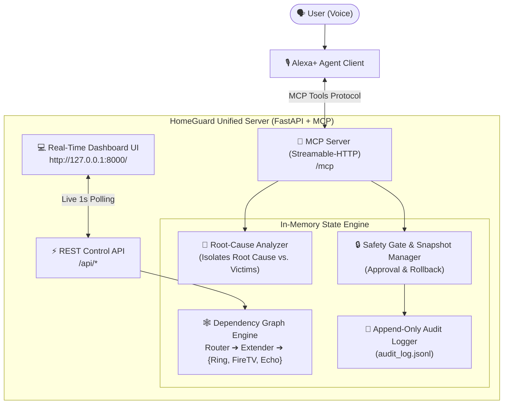

# HomeGuard: The Smart Home That Explains Itself

> *"When your Ring goes offline and your Fire TV starts buffering, Alexa+ tells you the one real cause and fixes it with your voice."*

Built for the **Amazon "Build, Ship, Shape" Hackathon (Alexa+ Track)**.

---

> [!WARNING]
> **SIMULATED DEVICES NOTICE**  
> **All smart home devices in HomeGuard (Router, Wi-Fi Extender, Ring Doorbell, Fire TV, Echo Speaker) are strictly SIMULATED.**  
> HomeGuard does not make calls to real Amazon, Ring, or hardware APIs. It is a full end-to-end working demonstration of conversational dependency-graph root cause analysis, safe confirmation gates, automated stabilization verification, and rollback.

---

## 💡 The Problem

Smart homes fail in bewildering cascade patterns. When an intermediate device like a Wi-Fi extender drops:
- Your **Ring Video Doorbell** goes offline.
- Your **Fire TV** starts buffering or drops video quality.
- Your **Echo Speaker** says *"Sorry, something went wrong"*.

To a homeowner, this looks like three unrelated breakdowns. People reboot their Fire TV, power-cycle their Echo, or fiddle with the Ring app—wasting time fixing symptoms while the real culprit remains broken.

## 🛡️ The Solution

HomeGuard models the home network as a **directed dependency graph**. When an anomaly occurs, it:
1. **Separates Root Cause from Victims**: Identifies that the Wi-Fi Extender is the single root cause while the Doorbell, Fire TV, and Echo are merely downstream victims.
2. **Explains Impact in Plain Language**: Calculates outage scope (e.g. *"Restarting will temporarily disconnect 4 devices for 60 seconds (Impact: MEDIUM)"*).
3. **Enforces Explicit Voice Confirmation**: A fix **NEVER** runs without direct user approval.
4. **Verifies Stabilization**: Runs multi-tick consecutive health checks before declaring victory.
5. **Auto-Rolls Back on Failure**: Takes a pre-fix snapshot; if stabilization fails, it automatically reverts to prevent a half-broken state.

---

## 👥 Who It Is For

- **Everyday Smart Home Owners**: Non-technical families who want plain-spoken explanations instead of error codes and technical jargon.
- **Smart Device Power Users**: Anyone managing multiple IoT devices who wants automated, safe self-healing with zero guesswork.
- **Elderly & Accessibility Users**: People who rely on voice interfaces (Alexa+) to diagnose and fix home issues without climbing behind furniture to pull power plugs.

---

## 🎙️ Built With Alexa+ (MCP)

HomeGuard exposes a self-hosted **Model Context Protocol (MCP)** server built with the official Python MCP SDK using **Streamable-HTTP transport**. Alexa+ (or any MCP-compatible agent) connects directly to HomeGuard to query tools:

| MCP Tool | Purpose | Spoken Voice Persona (`spoken`) |
|---|---|---|
| `home_status()` | Snapshot of all devices | *"All 5 simulated devices in your home are online and working normally."* |
| `diagnose_home()` | Graph RCA & victim separation | *"I found the issue. Your Wi-Fi Extender is offline. It is causing 3 other devices to fail."* |
| `propose_fix()` | States impact & asks confirmation | *"Restarting will disconnect 4 devices for about 60 seconds. Should I go ahead with the restart?"* |
| `approve_fix()` | Executes ONLY after user confirmation | *"I've restarted your Wi-Fi Extender. Checking if everything stabilizes."* |
| `verify_fix()` | Consecutive 3-tick stabilization check | *"All devices have stabilized. Your Ring, Fire TV, and Echo are all back online."* |
| `rollback_fix()` | Restores pre-fix snapshot | *"I have rolled back the fix and restored your devices to their previous state."* |

---

## 🏗️ Architecture



---

## ⚡ Quickstart

### Prerequisites
- Python 3.11+ (Python 3.11, 3.12, 3.13, or 3.14)
- Git

### 1. Clone & Set Up Environment

```bash
git clone <repo-url>
cd amasdbd

# Create and activate virtual environment
python -m venv .venv

# On Windows:
.venv\Scripts\activate

# On Linux/macOS:
source .venv/bin/activate

# Install dependencies
pip install -r requirements.txt
```

### 2. Configure Environment (Optional)

```bash
cp .env.example .env
```

### 3. Run the Unified Server & Live Dashboard

```bash
python -m homeguard.dashboard
```

The server starts at `http://127.0.0.1:8000`:
- **Live Web Dashboard**: [http://127.0.0.1:8000/](http://127.0.0.1:8000/)
- **Streamable-HTTP MCP Endpoint**: [http://127.0.0.1:8000/mcp](http://127.0.0.1:8000/mcp)

---

## 🎬 Exact Demo Walkthrough

You can run the end-to-end demo using the automated script or with two terminal windows.

### Automated Launcher

**On Linux / macOS:**
```bash
chmod +x demo/run_demo.sh
./demo/run_demo.sh
```

**On Windows:**
```cmd
demo\run_demo.bat
```

---

### Step-by-Step Manual Demo Script

1. **Open the Dashboard in your browser**:
   Navigate to [http://127.0.0.1:8000/](http://127.0.0.1:8000/).  
   Notice all 5 simulated devices are green (**ONLINE**) and the audit trail is idle.

2. **Start the Alexa+ Voice Simulator in a second terminal**:
   ```bash
   python demo/alexa_sim.py
   ```

3. **Simulate an Outage**:
   Click **"💥 Inject Extender Outage"** on the dashboard, or in the CLI type:
   ```text
   inject failure
   ```
   *Observation*: On the dashboard, **Wi-Fi Extender** pulses RED (**ROOT CAUSE**), while **Ring Doorbell**, **Fire TV**, and **Echo Speaker** immediately reflect downstream cascade (**VICTIMS**).

4. **Ask Alexa+ What Happened**:
   Type in the Alexa+ prompt:
   ```text
   what's wrong with my home
   ```
   *Alexa+ Response*:
   > *"I found the issue. Your Wi-Fi Extender is offline. It is causing 3 other devices, including your Ring Video Doorbell, Fire TV 4K, to fail. I recommend restarting your Wi-Fi Extender. This will briefly disconnect 4 devices for about 60 seconds. Should I go ahead with the restart?"*

5. **Approve the Fix**:
   Type:
   ```text
   yes go ahead
   ```
   *Alexa+ Response*:
   > *"I've restarted your Wi-Fi Extender. Checking if everything stabilizes."*  
   > *(Followed by verification check)*:  
   > *"All devices have stabilized across 3 checks. Your Ring doorbell, Fire TV, and Echo speaker are all back online."*  
   *Observation*: The dashboard devices turn green, and the audit log records the user approval, restart execution, and verification pass!

6. **Demonstrate Self-Checking Failure Verification (Bonus Demo)**:
   What if a fix fails? Type:
   ```text
   inject flaky
   ```
   Now ask:
   ```text
   what's wrong with my home
   ```
   Then confirm:
   ```text
   yes go ahead
   ```
   *Alexa+ Response*:
   > *"Verification failed on tick 2: Wi-Fi Extender did not stabilize. I automatically rolled back your settings to the previous state."*  
   *Observation*: Self-checking catches the faulty restart and restores the pre-fix snapshot automatically!

7. **Instant Rollback**:
   Say:
   ```text
   undo that
   ```
   *Alexa+ Response*:
   > *"I have rolled back the fix and restored your devices to their previous state."*

---

## 🧪 Running the Tests

HomeGuard includes a comprehensive pytest suite covering root cause analysis, approval safety gates, verification loops, auto-rollback, API endpoints, and the Alexa+ simulator:

```bash
pytest -v
```

All 25 tests pass in ~1.2 seconds.

---

## 📁 Repository Structure

```
amasdbd/
├── .env.example              # Environment variables template
├── .gitignore                # Git exclusions (venv, logs, .env)
├── LICENSE                   # MIT License
├── README.md                 # Complete project documentation
├── pyproject.toml            # Project packaging & pytest configuration
├── requirements.txt          # Pinned Python dependencies
├── docs/
│   └── FEEDBACK.md           # Hackathon SDK feedback template (MCP, Alexa+, FastAPI)
├── homeguard/
│   ├── __init__.py           # Package init
│   ├── core.py               # Pure domain logic: dependency graph, RCA, fix flow, audit
│   ├── mcp_server.py         # Official MCP Server (FastMCP, streamable-http)
│   └── dashboard.py          # FastAPI application serving UI and mounting MCP server
├── static/
│   └── index.html            # Single-page dashboard with SVG graph & live audit trail
├── demo/
│   ├── alexa_sim.py          # Interactive Alexa+ voice agent CLI simulator
│   ├── run_demo.sh           # Unix automated demo launcher
│   └── run_demo.bat          # Windows automated demo launcher
└── tests/
    ├── test_core.py          # Tests for graph topology, RCA, and core fix flow
    ├── test_mcp.py           # Tests for MCP tools, safety refusal, and rollback
    ├── test_dashboard.py     # Tests for FastAPI REST endpoints
    └── test_alexa_sim.py     # Tests for voice phrase dispatch logic
```

---

## 📜 License

This project is licensed under the MIT License - see the [LICENSE](LICENSE) file for details.
